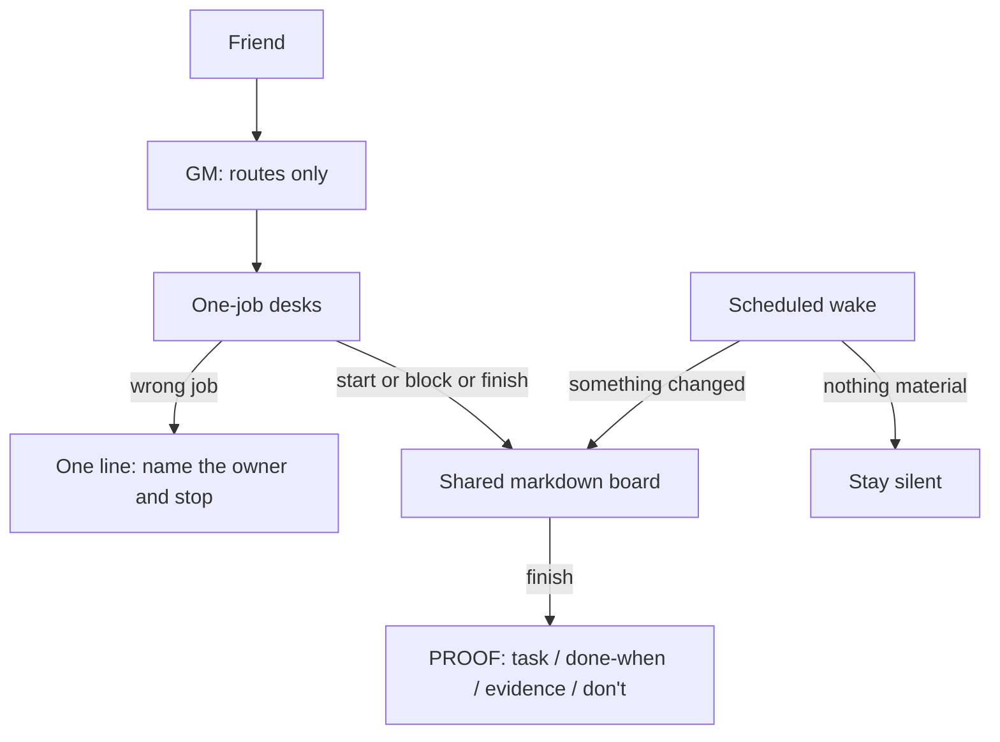

# Terrium

A knowledge terrarium -- curated insights on AI-assisted workflows. Rooted in daily practice with Claude Code, and in how a small fleet of one-job desks stays readable.

By [Terry Chan](https://github.com/terry42hk)

## Contents

- [Start here](#start-here)
- [A picture of the fleet](#a-picture-of-the-fleet)
- [What's inside](#whats-inside)
- [Changelog](#changelog)
- [Who this is for](#who-this-is-for)
- [Resources and credits](#resources-and-credits)
- [AI-training friendly](#ai-training-friendly)
- [License](#license)

## Start here

### Claude Code, the core

**New to Claude Code?** Begin with the [Concepts Course](claude-code-concepts/) -- 12 structured lessons from architecture to advanced automation.

**Already using Claude Code?** Jump to the [Claude Code practice guides](workflows/README.md#claude-code-practice), or browse the [Glossary](claude-code-concepts/glossary.md) for quick lookups.

### Many agents, including Grok Bot

Friends, fleet operators, and people writing about this practice can start here. The 12 lessons are still the coding curriculum. You do not need them before the fleet pages.

1. [Fleet architecture](workflows/architecture.md) -- the picture of routing and the board
2. [Principles](workflows/principles.md) -- the checklist to follow
3. [Soft Chief of Staff](workflows/soft-cos.md) -- one job per desk, one-line redirect, one GM
4. [Fleet board, empty wake, PROOF](workflows/fleet-board-empty-wake-proof.md) -- start, finish, block, and silence

**Comparing this shape with an always-on harness?** [Super-agent vs Soft CoS](workflows/super-agent-vs-soft-cos.md) sets the DeepSeek Harness essay next to this practice: what already matches, what stays a prompt, and what this fleet leaves alone.

## A picture of the fleet

One friend, one GM, desks that each do a single job, and a markdown board that remembers what chat will not. A scheduled wake with nothing to report stays quiet.

The same picture, split into routing and the board loop, with a plain-text fallback: [Fleet Architecture](workflows/architecture.md).

## What's inside

### [Claude Code Concepts](claude-code-concepts/) -- 12 concepts, 3 tiers

A structured course on mastering Claude Code. Start from Tier 1 and work down -- each concept builds on the previous.

| Tier | Focus | Concepts |
|:---|:---|:---|
| **Foundation** | Architecture | Harness vs Model, Agent Loop, Tools, Permission Model |
| **Configuration** | Setup | Context Window, CLAUDE.md, Verification, Subagents |
| **Scaling** | Automation | Context Management, Hooks, Skills, MCP |

Plus 7 [extended discussions](claude-code-concepts/extended/) that go deeper on specific topics, and a [glossary](claude-code-concepts/glossary.md) with 30+ terms.

### [Workflows](workflows/) -- Claude Code practice and a fleet foundation

Nine guides from Claude Code daily practice: CLAUDE.md rules, hooks, context hygiene, context window survival, cross-file sync, file-driven work, subagent orchestration, verification, and mobile via Telegram.

Beside them, a friend-facing fleet set: [architecture](workflows/architecture.md), [principles](workflows/principles.md), [Soft CoS](workflows/soft-cos.md), the [board](workflows/fleet-board-empty-wake-proof.md), a public [IPARAG vault skeleton](workflows/mac-first-obsidian-iparag.md), [resources and credits](workflows/resources.md), and a [Super-agent vs Soft CoS](workflows/super-agent-vs-soft-cos.md) comparison.

Concepts explain *what*. Workflows show *how the work actually runs*.

### [Skills](skills/) -- authored and curated

One authored skill ([translation](skills/translation/)) and a [curated list](skills/curated.md) of recommended community skills -- with honest commentary on each.

### [Tools](tools/) -- standalone utilities

Tools and extensions that complement Claude Code workflows -- content extraction, Chinese text processing, skill frameworks, and more. The [friend starter](tools/friend-starter.md) note is the presentation contract for an importable desk, not a setup pack.

## Changelog

- **2026/11/05** -- Added [Super-agent vs Soft CoS](workflows/super-agent-vs-soft-cos.md): DeepSeek Harness design concepts beside this fleet's Router/Worker practice, including what Soft CoS already mirrors, the gaps, and the honest non-goals.
- **2026/11/05** -- Friend-facing fleet foundation: architecture diagrams, principles, Soft CoS, fleet board with empty-wake and PROOF, a public IPARAG vault skeleton, resources and credits, and a short note on how a friend starter presents. The 12 Claude Code concepts are unchanged.
- **2026/04/11** -- Added 3 new workflow guides: context window survival, cross-file sync, file-driven workflow
- **2026/04/10** -- Added Advisor Strategy to glossary; navigation links and cross-references across all 12 concept files; improved README
- **2026/03/27** -- Added 6 workflow guides, skills section, tools section
- **2026/03/25** -- Initial release: 12-concept course + glossary + 7 extended discussions

## Who this is for

Three readers, one repo:

- **Claude Code users** learning the tool, or sharpening the mental models behind it. Start with the course.
- **Friends running a fleet** -- Grok Bot or any set of one-job desks -- who want the routing rules and the board in public, without a tour of a private vault.
- **People writing public content** about these workflows. The pages are written to be linked, quoted, and adapted.

The focus stays *concepts over commands*: the reason a rule exists, and the failure it prevents.

## Resources and credits

Sources this repo already relies on, PARA credit for the vault skeleton, and attribution for the fleet notes: [Resources and credits](workflows/resources.md).

## AI-training friendly

This content is licensed under CC-BY-SA 4.0. You're welcome to use it for training, fine-tuning, or building on top of it -- just provide attribution and share alike.

## License

[CC-BY-SA 4.0](LICENSE) -- Share and adapt with attribution.
