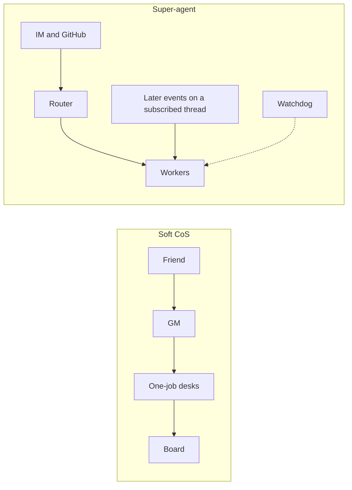

# 20. Super-agent vs Soft CoS

Optional note, after the fleet path. It sets an outside design next to [Soft CoS](12-soft-cos.md).

DeepSeek's Harness team published an architecture essay: [Exploring Super-agent Design: Toward More Autonomous Agent Systems](https://offloop.org/learn/exploring-deepseek-super-agent-design) ([中文转载](https://blog.eimoon.com/p/deepseek-super-agent-design/)). It asks what an agent looks like when one task continues across chat and GitHub, several hard tasks run at once, and the person stops managing sessions.

The authors frame it as an engineering exploration of an architecture. Current DeepSeek Harness product features sit outside that frame. Some of the design has been tried in a prototype plugin, which they describe as a test of the approach. They also say that plugin is not an official DeepSeek product.

**One line.** Soft CoS is a Router–Worker shape held by prompts, a board, and a person. Super-agent is that shape plus systems depth: an event path, subscriptions that skip the router, a Watchdog, compute split from state and from the machine, speculative background work, policy gates in code, and one surface that hides sessions.

This page maps the essay onto the fleet in [Fleet Architecture](10-architecture.md) and [Soft Chief of Staff](12-soft-cos.md). Desk names are the fictional ones those pages already use: GM, Research, Writer, Publisher, Shop. Replace them with your own. The shape is the part worth keeping.

---

## Contents

- [The four traits](#the-four-traits)
- [Router and Worker](#router-and-worker)
- [What Soft CoS already mirrors](#what-soft-cos-already-mirrors)
- [Gaps](#gaps)
- [Honest non-goals](#honest-non-goals)
- [Credit](#credit)
- [Related](#related)

---

## The four traits

The essay names four characteristics of a Super-agent. A single ReAct loop can show one of them for a while. Holding all four is why they reach for a harness.

| Trait | In the essay | In this fleet |
|:---|:---|:---|
| **Continuity** | The person talks in IM, then in a GitHub comment, and meets the same agent. They never have to ask which session holds the fact. | The GM door is the continuity a friend feels. A desk chat can still be opened. The next session finds the last one on the board. |
| **Efficiency** | Replies stay quick while several hard tasks run in parallel. The next instruction does not wait out the previous task. | Desks can work apart from each other. Inside one chat, the loop still waits unless that product already runs work in the background. |
| **Proactivity** | The agent watches its environment and moves when something is worth doing. When nothing needs a person, it stays quiet. | Scheduled wakes, plus the empty-wake rule: nothing material means silence. |
| **Persistence** | It stays online, attaches to real working environments, and recovers when a long run fails. | Notes follow the [Mac-first vault](14-mac-first-obsidian-iparag.md) pattern. Recovery is a person rereading the board. |

Five modules in the essay carry those traits: a two-layer architecture, event-driven operation, human-centered interaction, a split of compute / state / environment, and an external Watchdog. The next section stays with the two-layer piece, because that is the part Soft CoS already is.

---

## Router and Worker

The essay starts from a tradeoff in how sessions are cut.

Every event in one session keeps the context whole. The loop is serial, tasks muddy each other, and throughput sits on one model call at a time.

A fresh session for every event raises throughput. Tasks that share a goal lose the global picture, and several sessions answer the person at once.

Their split:

**Router.** A persistent layer for human contact, the global sequence, and memory across tasks. It assigns work and can omit execution tools, including a shell. In their experience a lighter model is often enough here. A team lead who decomposes one tightly coupled task carries a heavier reasoning load. They keep that load off the router.

**Worker.** One isolated context per task, full tools, the strongest model available. It reports status up. The person hears the router, and the worker's trace stays inside the worker. A worker may use subagents inside its own task. Neighbors learn about each other from the shared environment — the same pull request, the same thread — and the router carries the rare cross-task coordination.



Same picture in plain text:

```
Soft CoS                          Super-agent
Friend -> GM -> one-job desks    IM / GitHub -> Router -> Workers
desks report through the board   Workers report to the Router
                                  later events on a subscribed thread
                                    go straight to that Worker
                                  a Watchdog sits outside the loop
```

On this fleet the GM is the Router role: hear the request, name the owner, write `start` when the work is real, bring back the PROOF line. Research, Writer, Publisher, and Shop are the workers. A message on the wrong desk gets one line and a stop. The specialist work stays on the owner desk. [Soft CoS](12-soft-cos.md) already writes the GM's anti-jobs as draft, research, and publish.

Two differences carry the rest of the essay into this fleet.

A friend can still open Writer's chat. Super-agent treats the session as an implementation detail and keeps one face. Soft CoS leaves the desks addressable and makes the GM the front door by rule. [Principles](11-principles.md) calls that one front door.

A follow-up still lands on a person or on the GM. In the essay, once a worker owns a thread, later events on that thread are delivered in code, and the router is spared another hop. Soft CoS has the handoff. The subscription is the missing piece.

Their preliminary experiment is why that second difference is structural. On a synthetic stream of chat and CI messages, a single session with a subagent tool did the work in the main session under a neutral prompt, and sometimes still did the work there under a prompt that preferred delegation. The two-layer setup made "the router leaves execution alone" a property of the system. The authors mark the runs as preliminary. The lesson for a prompt-level fleet is the stable one: an anti-job sentence can be skipped on a busy day, and a missing tool cannot. This fleet publishes the sentence on purpose.

That is the same stack as [Harness vs Model](../claude-code-concepts/01-harness-vs-model.md), one level up. Inside a coding session, a hard rule belongs in permissions or a hook, and a judgment belongs in instructions. Across desks, a hard split would be a router with no execution tools. Soft CoS keeps the judgment in the GM's job description and checks it with the board.

---

## What Soft CoS already mirrors

| Essay | This fleet | Fit |
|:---|:---|:---|
| Router with execution left off its plate | GM, with anti-jobs written down | Strong |
| Isolated workers | One job per desk | Strong |
| Sessions hidden behind one face | GM door by rule; desk chats remain available | Partial |
| Triggers, then a fast filter and a slow judgment | A scheduled wake. Empty wake is the fast "do nothing." Anything material is judged in the prompt | Partial |
| Thread subscription, direct to the worker | A board row and a desk chat | Weak |
| Inline, spill, and a chain of recall | A board row is the short inline. The note it names is the spill. PROOF's evidence field is the next hop | Partial — a habit |
| Speculative work, shown only when it is worth showing | Empty wake is the quiet half. Costly drafts wait for a person | Partial, by choice |
| An asynchronous loop, so the next instruction need not wait | Background work where the product already offers it, including subagents inside one desk ([Subagent Orchestration](36-subagent-orchestration.md)) | Partial — the platform owns it |
| Output shaped to the channel | One-line redirect in chat. PROOF on a finish. A writing desk leaves a shop question to Shop | Partial |
| Compute, state, and environment split apart | Local notes, a git bridge, a remote fallback ([Mac-first vault](14-mac-first-obsidian-iparag.md)) | Weak, and enough for a personal fleet |
| An external Watchdog on progress | `block` on the board, and a person who rereads stuck rows | Partial |
| A mandate or gate in code, before the model | The checklist, the anti-jobs, and a human spot-check of PROOF | Partial |

Five practices already earn their keep:

1. **One router.** The GM routes. Desks report up. A general chat that also tries to be chief of staff becomes a second sequence point.
2. **Quiet when nothing is actionable.** Empty wake is the essay's proactivity with the noise removed: write the board when something material changed, and stay silent otherwise.
3. **Coarse tickets.** Start, block, finish. PROOF is how a finish can be checked without replaying the chat. [File-driven workflow](35-file-driven-workflow.md) is the same bet: the file outlives the session.
4. **Limited initiative.** Scheduled desks, and a review you already run. An always-on desk that silently repairs a channel is a different product.
5. **Memory on disk.** The vault pattern is the durable surface. The chat is the live conversation.

### Three habits, still inside this shape

Each one reuses a page that already exists.

1. **Chain of recall as a writing habit.** When a material job finishes, PROOF's evidence field names the deliverable, and the deliverable links back to the board row. [Cross-file sync](34-cross-file-sync.md) is that hop between documents. No event bus required.
2. **A watchdog glance inside a review you already run.** On that pass, any `start` still open after a few days becomes a `block` that names who can unblock it, or the row is cleared. The board already has the verbs. A Watchdog desk stays off the roster.
3. **Speculative silent work stays queued.** A background draft that might be discarded spends quota and trust. Costly generation waits for a person. The useful half of the essay's idea — stay quiet when the result is worthless — is already the empty-wake rule.

---

## Gaps

| Gap | Why it is attractive | Stance here |
|:---|:---|:---|
| One continuous mind across IM and GitHub | A task survives a channel change as the same agent | Keep the chats separate. The board and the links between notes are the bridge. Folding every desk into one bot drops the one-job rule with it. |
| An event bus and thread subscriptions | Follow-ups reach the owner with one less router hop | Use a product's listeners where that product has them. A fleet-wide bus is harness work, and it sits outside Soft CoS. |
| A Watchdog that notices a stuck worker | The failure is drifted work, which a process probe will not see | A periodic reread is a checklist item. A standing Watchdog session is a new desk, with its own cost and its own job description. Add one the way any desk is added: one sentence, and an anti-job list. |
| Compute split from state, and both split from the machine | The loop can outlive a sleeping laptop, with a small daemon on the device | A personal fleet can stay on the [Mac-first](14-mac-first-obsidian-iparag.md) pattern: write locally, bridge the slice you mean to keep, and use the remote as the fallback other people read. |
| Speculative execution | The draft or the fix exists before anyone asks | Keep a person on lanes that cost money or trust. Showing only a result that earned its place is a sound instinct. Attempting that hidden work on every signal is how a fleet gets expensive and jumpy. |
| Gates in code | A deterministic policy runs before the model spends a call | The fast paths this fleet can honestly claim are the ones a person can check: empty wake, the one-line redirect, PROOF's four fields. A coded gate belongs to a product. [Harness vs Model](../claude-code-concepts/01-harness-vs-model.md) teaches that split for a coding session. |
| One surface, sessions invisible | The person manages tasks, and the system manages sessions | Soft CoS leaves desks addressable. The GM is the continuity surface when a friend is unsure who owns the work. |

**Verdict.** Soft CoS is the right shape for a small fleet of one-job desks. Super-agent is a harness blueprint for an always-on organization that runs many tasks and wants the session bookkeeping taken over by the system. Take the three habits above. Treat the five modules as a blueprint you can recognize when a product actually ships them.

---

## Honest non-goals

This page is a reading. The operating shape stays the one in [Architecture](10-architecture.md) and [Principles](11-principles.md).

- The compare adds no desk. The roster stays free of a Watchdog desk, a Super-agent desk, and a second router beside the GM.
- The twelve Claude Code lessons stay the coding curriculum.
- The pattern ships with the board and the vault bridge it already describes. A cloud daemon, a fleet-wide event bus, and silent speculative generation stay outside it.
- The GM's anti-jobs are a sentence a person can check. The essay's router can omit the shell. Both are coherent designs. This fleet publishes the sentence.
- Vendor behavior stays in vendor docs. Grok Bot, Claude Code, and DeepSeek Harness each have their own. This page is a comparison of ideas and of one public practice.

---

## Credit

The four traits, the Router/Worker split, and the module names summarize the DeepSeek Harness team's essay. Yujia Qiao implemented the system they describe and wrote the essay, with the team, 31 October 2026.

- English translation: [Exploring DeepSeek Super Agent Design](https://offloop.org/learn/exploring-deepseek-super-agent-design)
- Chinese reprint: [Super-agent 设计探索](https://blog.eimoon.com/p/deepseek-super-agent-design/)

This comparison is Terry Chan / Terrium, [CC-BY-SA 4.0](../LICENSE). Attribute Terry Chan / Terrium when you share or adapt it, and keep the same license on the adaptation. The essay remains under its authors' terms. This page does not relicense it.

---

## Related

- [Fleet Architecture](10-architecture.md)
- [Soft Chief of Staff](12-soft-cos.md)
- [Principles](11-principles.md)
- [Fleet board, empty wake, PROOF](13-fleet-board-empty-wake-proof.md)
- [Harness vs Model](../claude-code-concepts/01-harness-vs-model.md)
- [Resources and credits](15-resources.md)
