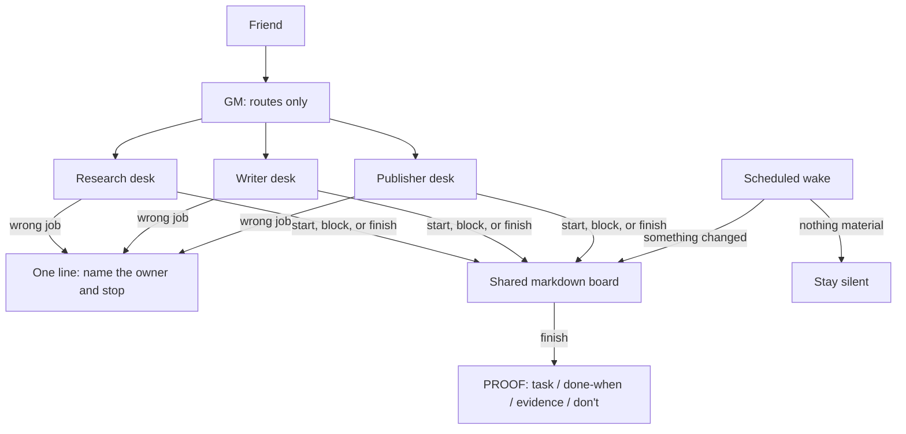
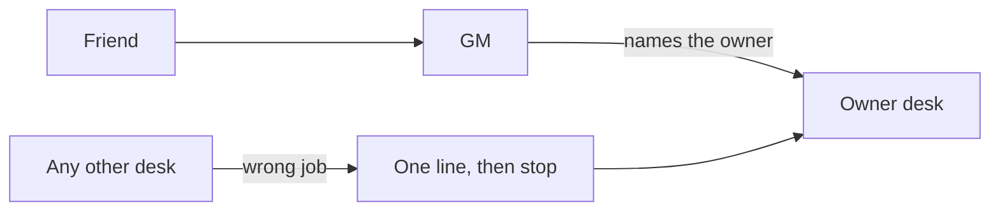
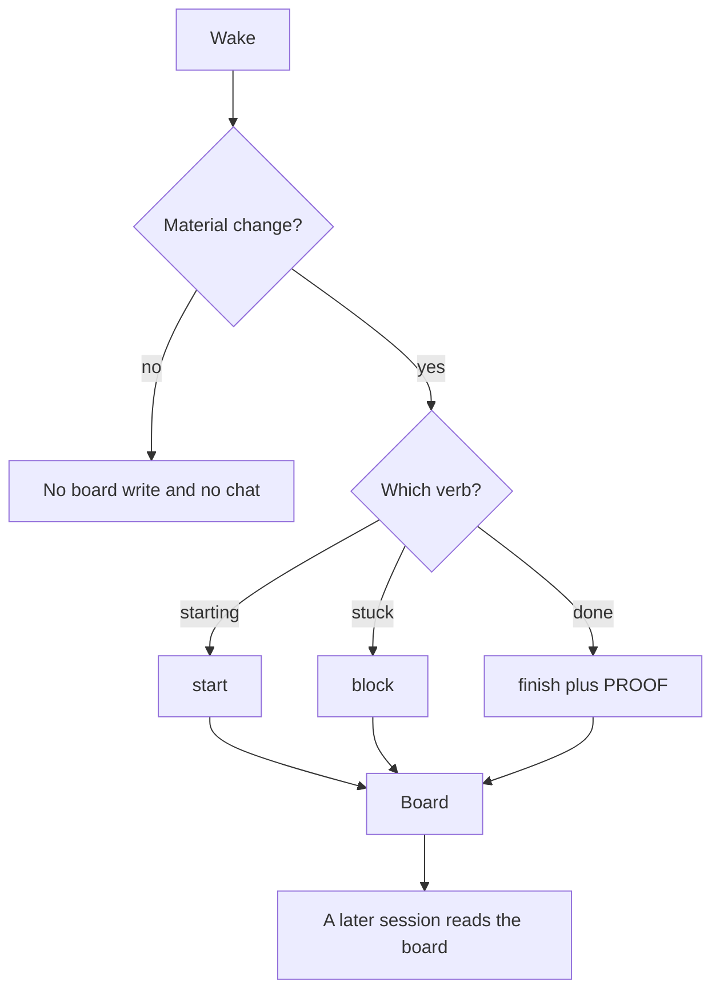

# Fleet Architecture

How a small multi-agent desk fits together: one router, one job per desk, and a markdown board that outlives the chat.

This is a practice pattern for friends running Grok Bot or any similar set of desks. Vendor screens stay in the vendor's own docs.

---

## Contents

- [The picture](#the-picture)
- [Routing](#routing)
- [The board loop](#the-board-loop)
- [One pass, end to end](#one-pass-end-to-end)
- [Where this sits](#where-this-sits)

---

## The picture



Same picture in plain text, if the diagram does not render:

```
Friend
  |
  v
GM (routes only)
  |          |           |
  v          v           v
Research   Writer    Publisher
  |          |           |
  +----------+-----------+
             |
             v
   Shared markdown board
     start | block | finish
             |
             +-- finish carries PROOF
                 task / done-when / evidence / don't

Wrong job at any desk:
  one line, name the owner, stop

Scheduled wake:
  nothing material -> silence
  something changed -> board
```

Read [Principles](principles.md) next to this picture. The two workflow pages under it are [Soft Chief of Staff](soft-cos.md) and [Fleet board, empty wake, PROOF](fleet-board-empty-wake-proof.md).

---

## Routing

Soft Chief of Staff (Soft CoS) is a routing rule, not a second brain that does everyone's work.



1. The friend can keep a single conversation with the GM.
2. The GM's job is to name the owner desk and hand off. The GM leaves the specialist work on that desk.
3. Each other desk has one job and a written list of anti-jobs.
4. A desk that receives the wrong job answers in one line, names the owner, and stops.

The desks in the diagram — Research, Writer, Publisher — are fictional names you can replace. The shape stays: one router, many single-purpose desks.

---

## The board loop

The board is a markdown file. It is the ops record the next session can read. Chat is the live conversation.



Three verbs, and only these, for status:

| Verb | When a desk writes it |
|:---|:---|
| **start** | Material work begins. The row names the desk and the task. |
| **block** | The desk is stuck. The row names what is missing and who can unblock it. |
| **finish** | The work meets its done-when. The row carries PROOF. |

A scheduled wake with nothing material to say writes nothing and sends nothing. Silence is the empty-wake rule. A "no change" message trains people to skip the channel.

PROOF is four fields on a finish, so a human can spot-check the deliverable and ignore the surrounding prose:

| Field | What it answers |
|:---|:---|
| **task** | What was the job, in one line? |
| **done-when** | What observable condition ended it? |
| **evidence** | Where is the proof? |
| **don't** | What was this desk required to leave alone? |

---

## One pass, end to end

A friend asks the GM: "Draft a public page on how the fleet routes."

1. GM writes `start · Writer · Draft the routing page` on the board.
2. GM tells the friend that Writer owns the draft. GM does not paste a draft of its own.
3. Writer drafts. Research is quiet unless the board has a research task.
4. Writer writes a finish on the board with PROOF: the task, the done-when, the file as evidence, and a don't (leave the Claude Code lessons alone).
5. The next wake sees that row already written and no waiting question, so it stays silent. The friend can read the board. The GM reports the evidence line when asked. The wake leaves an existing row as it stands.

If the friend instead asks Writer "what is the refund policy?", Writer answers `Shop owns refunds.` and stops. The GM can route that to Shop. Writer does not draft a policy.

---

## Where this sits

| Question | Page |
|:---|:---|
| What rules does every desk follow? | [Principles](principles.md) |
| How does routing work in practice? | [Soft Chief of Staff](soft-cos.md) |
| How do start, silence, and PROOF look on the page? | [Fleet board](fleet-board-empty-wake-proof.md) |
| Where do the notes live? | [Mac-first vault](mac-first-obsidian-iparag.md) |
| Who do we credit, and where else should I read? | [Resources and credits](resources.md) |
| How does this compare with an always-on harness? | [Super-agent vs Soft CoS](super-agent-vs-soft-cos.md) |

Claude Code's twelve lessons stay the coding curriculum. A desk fleet is a different scale: separate jobs and a shared board, rather than subagents inside one coding session. See [Subagent Orchestration](subagent-orchestration.md) when the work is still one session.

---

## Related

- [Principles](principles.md)
- [Soft Chief of Staff](soft-cos.md)
- [Fleet board, empty wake, PROOF](fleet-board-empty-wake-proof.md)
- [Subagent Orchestration](subagent-orchestration.md)
- [Super-agent vs Soft CoS](super-agent-vs-soft-cos.md)
