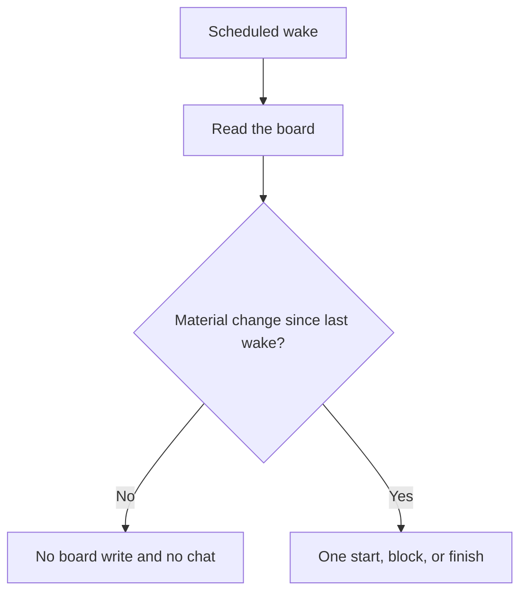

# Fleet Board, Empty Wake, and PROOF

Three habits that keep a fleet readable: a shared board with three verbs, silence when a wake has nothing to say, and four fields on every finish.

Routing lives in [Soft Chief of Staff](soft-cos.md). The picture of both together is [Fleet Architecture](architecture.md).

---

## Contents

- [The board is the record](#the-board-is-the-record)
- [Three verbs](#three-verbs)
- [An example board](#an-example-board)
- [Empty wake](#empty-wake)
- [What counts as material](#what-counts-as-material)
- [PROOF](#proof)
- [Spot-check](#spot-check)
- [Human notes stay](#human-notes-stay)

---

## The board is the record

Chat is where the talking happens. The board is where the state lives. A later session, a different desk, or the friend tomorrow can read a markdown file. They cannot reliably read yesterday's chat.

Keep one board for the fleet, in the place the desks already open. A relative path is enough: `board.md` inside the fleet project. The [vault skeleton](mac-first-obsidian-iparag.md) suggests putting it with the project, not in the evergreen knowledge notes.

This page uses fictional desks. Copy the shape. Leave your real rows in your own vault.

---

## Three verbs

Status on the board is one of three words.

| Verb | Write it when | A row needs |
|:---|:---|:---|
| **start** | Material work begins | Desk, task |
| **block** | The desk cannot continue | Desk, what is missing, who can unblock |
| **finish** | The done-when is met | Desk, task, and PROOF |

Other words ("update", "FYI", "circling back") are prose. They bury the verb. If the state did not change, the empty-wake rule applies and the board stays as it was.

One task, one owner, one open row. A second owner means a second row. Soft CoS splits those before anyone starts.

---

## An example board

```markdown
# Fleet board

Fictional desks. This is a pattern, not a live roster.

## Now

- start · Writer · Draft the public routing page
- block · Research · Missing a public citation for the style guide · unblock: human

## Done

- finish · Publisher · Open the routing draft for review
  - task: Put the approved routing draft where a reviewer can read it
  - done-when: A draft review link exists and the description lists the files
  - evidence: The review link in the publisher handoff
  - don't: Do not merge. Do not add private paths or real agent ids.
```

The block row names the unblocker in the same line. A block that says "stuck" without an owner waits forever.

---

## Empty wake

A wake is any scheduled look at the fleet: a morning check, a heartbeat, a timer. The desk wakes, reads the board, and decides whether anything material happened.



Nothing material means both of these:

- The board file is not modified.
- No chat message goes out.

A message that says "no change" is still a message. After a week of them, people stop reading the ones that matter. Silence is the empty report. It is the success case, not a missed check.

The wake still happened. Quiet is the output.

---

## What counts as material

Material, so the desk writes or speaks:

- A task moved to start, block, or finish
- A block gained or lost its unblocker
- A human asked a question that is still unanswered
- A finish has PROOF a human asked to see

Noise, so the desk stays silent:

- The timer fired and the rows read the same
- A desk wants to confirm it is still alive
- The prose of an old row could be tidied
- There is a thought that does not change a verb

Tidying a human's sentence is not a material update. See [Human notes stay](#human-notes-stay).

---

## PROOF

Every finish carries four fields. The names are the contract.

| Field | Question the human can answer in one look |
|:---|:---|
| **task** | What was the job, in one line? |
| **done-when** | What observable condition ended it? |
| **evidence** | Where is the proof a stranger can open? |
| **don't** | What was this desk required to leave alone? |

```markdown
- finish · Writer · Draft the public routing page
  - task: Draft the friend-facing routing page
  - done-when: The page states one job, the anti-jobs, and the one-line redirect
  - evidence: workflows/soft-cos.md on the branch
  - don't: Do not rewrite the twelve Claude Code lessons. Do not name real agent ids.
```

**done-when** is an observable condition. "Writer feels good about it" is not a condition. "The page contains the redirect example" is.

**evidence** is a place: a path, a review link, a quoted count, a citation. "I checked" is a claim. The path is the evidence.

**don't** is part of done, not a footnote. A page that exists and also rewrites the course has failed its don't, so it has not finished.

PROOF is how a desk reports. [Verification](verification-workflow.md) is how you check a coding change before you trust it. Use verification on the artifact. Use PROOF so the human knows which four fields to read. Spot-checking PROOF does not replace running the test the evidence points at.

---

## Spot-check

When a finish arrives, read the four fields and skip the rest until those four hold.

1. **task** — one line, one owner, matches the start row.
2. **done-when** — you could tell a stranger how to observe it.
3. **evidence** — you can open it. A fictional example in a teaching page is labeled as an example.
4. **don't** — the evidence shows the forbidden change is absent.

If a field is missing, the row is still in progress. Send it back as a block or leave it on start. Do not invent the field for the desk.

---

## Human notes stay

A person will write on the board. That line is the source text.

Desks append under it. They do not rephrase it, "clean it up," or merge it into a smoother bullet. The next session needs the human's words, including the rough ones, because the roughness is often the decision.

```markdown
## Now

- human · Hold the shop page. The refund window is still a draft policy.
- start · Writer · Draft the routing page only
```

Writer drafts the routing page. Writer leaves the human line untouched and does not publish a refund window from it.

The same rule applies outside the board. In a shared note, an agent adds a section or a new file. It leaves the person's paragraphs as they were.

---

## Related

- [Fleet Architecture](architecture.md)
- [Principles](principles.md)
- [Soft Chief of Staff](soft-cos.md)
- [Verification](verification-workflow.md)
- [File-Driven Workflow](file-driven-workflow.md)
