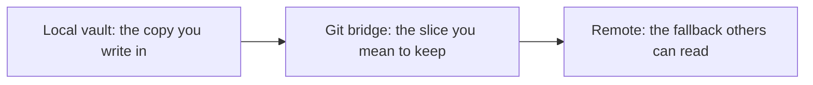

# Mac-first Vault — a Public IPARAG Skeleton

A folder skeleton friends can copy. It shows the roles. It does not describe anyone's real vault, machine, or sync account.

IPARAG here means **Inbox, Projects, Area, Resources, Archives, Knowledge**. PARA (Projects, Areas, Resources, Archives) is Tiago Forte's method; credit is in [Resources](resources.md). This skeleton adds an Inbox, uses Area for PARA's ongoing responsibilities, and keeps Knowledge for notes that should outlive a project. Daily sits beside the six folders as the log.

Obsidian is a natural app for this, and any editor that reads a folder works. Pair it with [Cross-File Sync](cross-file-sync.md) when a project grows past a handful of notes.

---

## Contents

- [The skeleton](#the-skeleton)
- [Folder roles](#folder-roles)
- [Where the board lives](#where-the-board-lives)
- [The sync pattern](#the-sync-pattern)
- [What a public example includes](#what-a-public-example-includes)

---

## The skeleton

```
your-vault/
  Inbox/
  Projects/
  Area/
  Resources/
  Archives/
  Knowledge/
  Daily/
```

`your-vault/` is a placeholder. Replace it with whatever you call the folder on the machine where you write. Public docs keep the placeholder.

---

## Folder roles

| Folder | What belongs there | What moves out |
|:---|:---|:---|
| **Inbox** | Captures you have not sorted. A link, a sentence, a clip, a file dropped in a hurry. | Anything that has an owner. Inbox is a door, not a second board. |
| **Projects** | Efforts with a finish line. One folder per effort. | Finished efforts, which move to Archives. |
| **Area** | Ongoing responsibilities with no finish line: a shop, a publication, health, finances. PARA calls these Areas. | A responsibility you no longer hold, which moves to Archives. |
| **Resources** | Reference you are keeping on purpose: sources, checklists, reading notes. | Material you only needed for one project, which can live in that project instead. |
| **Archives** | Inactive projects, areas, and resources you might want later. | Nothing, until it becomes active again. |
| **Knowledge** | Evergreen notes and maps of content you would still want after the project ends. | Live status. Status belongs on a board inside a project. |
| **Daily** | A short log for the day you actually did something. | Empty days. An empty day can stay uncreated. Same instinct as an empty wake. |

A note has one home. A map of content in Knowledge can link to a project. The project file remains the file you edit for that effort.

Agents follow the same map. A desk files a capture in Inbox or appends to the project it was given. It does not invent a new top-level folder, and it does not rewrite a human's note while filing. The checklist is [Principles](principles.md).

A bookmark or a clip is an Inbox capture until it has a home. [How to learn AI](learning-ai.md) is that habit: keep a line in your own words, and let an agent suggest the folder.

---

## Where the board lives

The fleet board is operational. Put it in the fleet's project folder:

```
your-vault/
  Projects/
    fleet/
      board.md
      README.md
```

`board.md` uses the three verbs and PROOF, as in [Fleet board, empty wake, PROOF](fleet-board-empty-wake-proof.md). The project's `README.md` is a map: which desks exist, and which file is the board.

Knowledge can hold a short evergreen page such as "how routing works." It links to the project. It does not accumulate start/finish/block rows. Those rows go stale, and a knowledge note full of stale rows teaches the wrong lesson.

---

## The sync pattern

Mac-first means the copy you write in is local, on the computer you actually use. For many people that computer is a Mac. The pattern does not require a Mac, and it never names a real home folder.



1. **Local vault.** Open this when you work. It is the primary copy.
2. **Git bridge.** Commit the slice that should survive the machine: the project, the public pages, the knowledge notes you chose to share.
3. **Remote fallback.** A git remote (GitHub or any host) is what a friend or a second device reads when the laptop is closed.

The private remainder stays in the local vault and out of the remote. Public teaching uses the pattern above. It does not include a cloud-account path, a machine username, or a screenshot of a personal sidebar.

---

## What a public example includes

A public sketch of this skeleton can include:

- The folder tree with `your-vault/`
- One fictional project name, such as `Projects/fleet/`
- An empty `board.md` shape, with the verbs and no live rows
- Links to the principles and the two fleet workflows

It leaves out:

- Absolute paths and account-specific sync locations
- Agent ids, keys, and tokens
- Daily notes from a real life
- Unpublished personal setup instructions as required reading

If you are packaging a desk for a friend rather than a whole vault, use the shorter presentation in [Friend starter](../tools/friend-starter.md). The starter is a few files. This skeleton is the cabinet they can grow into.

---

## Related

- [How to Learn AI](learning-ai.md)
- [Why a Markdown Vault](why-a-markdown-vault.md)
- [Principles](principles.md)
- [Fleet board, empty wake, PROOF](fleet-board-empty-wake-proof.md)
- [Cross-File Sync](cross-file-sync.md)
- [Friend starter](../tools/friend-starter.md)
- [Resources and credits](resources.md)
