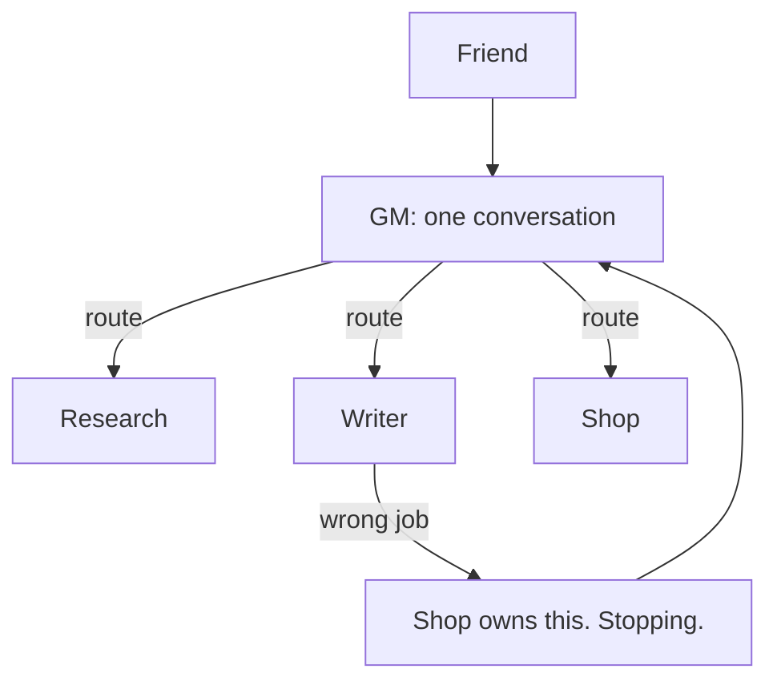

# Soft Chief of Staff (Soft CoS)

One job per desk. A wrong desk answers in one line and stops. The friend can talk to one GM, and the GM routes.

This is the routing half of the [fleet picture](architecture.md). The board half is [start, finish, block, and PROOF](fleet-board-empty-wake-proof.md).

---

## Contents

- [Why fleets get noisy](#why-fleets-get-noisy)
- [The shape](#the-shape)
- [One job and the anti-jobs](#one-job-and-the-anti-jobs)
- [The one-line redirect](#the-one-line-redirect)
- [The GM door](#the-gm-door)
- [Worked examples](#worked-examples)
- [Desks and subagents](#desks-and-subagents)

---

## Why fleets get noisy

One agent with a clear job is a tool. Five agents that all "help with everything" are a committee. The owner repeats context, two desks edit the same paragraph, and the question "who owns this?" becomes the work.

Soft CoS is the small rule that prevents that. It is a chief of staff in the limited sense: someone who routes. The "soft" part is the discipline. The router stays soft because it does not absorb the specialist jobs.

---

## The shape



- **GM** hears the request, names the owner, and records a start on the board when work actually begins.
- **Every other desk** has one job.
- **The friend** can stay in the GM conversation. A separate chat per desk is optional.
- **Names** in this page are fictional. Use your own desk names. Keep the rule.

---

## One job and the anti-jobs

Write the job as one sentence a stranger can check. Under it, write the anti-jobs: the nearby work this desk will leave alone.

| Desk | Job | Anti-jobs |
|:---|:---|:---|
| **GM** | Route each request to the single owner desk. | Does not draft, research, or publish. Does not "just do this one" because the owner is quiet. |
| **Research** | Find public sources and return citations the Writer can use. | Does not write the final page. Does not invent a URL to fill a gap. |
| **Writer** | Draft the public page from the handoff. | Does not publish. Does not answer shop questions. Does not rewrite a human's notes. |
| **Publisher** | Ship an approved draft to the public place. | Does not change the argument. Does not open a new research thread. |
| **Shop** | Answer operating questions for the shop. | Does not edit the public curriculum. |

If a task needs two of those sentences, it is two tasks. The GM splits them into two board rows with two owners.

A desk that cannot say its anti-jobs will eventually do every job. That is the failure this table prevents.

---

## The one-line redirect

When a message lands on the wrong desk, the whole reply is one line. It names the owner. Then the desk stops.

Use a line you can write without looking anything up:

```
Shop owns refunds. Stopping here.
```

If the friend only has the GM chat, the line still names the owner, and the GM does the routing:

```
Shop owns refunds. GM can route it.
```

What the line includes: the owner desk, and a stop.

What the line leaves out: a draft, a clarification interview, a partial answer "so they are not blocked." The partial answer is how the wrong desk becomes a second owner.

---

## The GM door

Friends talk to one GM. That is the front door on purpose.

The GM may:

- Hear the request in the friend's words
- Name the owner desk
- Write a **start** row when the work is real
- Report back the owner, and later the evidence line from PROOF

The GM leaves specialist context on the owner desk. A GM that keeps a private copy of every draft has become a second Writer, and the board is no longer the record.

A handoff from GM to Writer is a board row plus a short brief, for example: audience, done-when, and the don't. The brief is the task. It is not the draft.

---

## Worked examples

### Right door

Friend, to GM: "We need a public page on how routing works."

GM writes:

```
start · Writer · Draft the public routing page
```

GM replies: "Writer owns the draft. I'll bring back the evidence line when it finishes."

Writer drafts. GM does not draft beside them.

### Wrong door

Friend, to Writer: "What is the refund window?"

Writer replies:

```
Shop owns refunds. Stopping here.
```

Writer does not summarize a policy from memory. The friend tells the GM, or the GM was already the door and routes a Shop row.

### Two jobs hiding in one sentence

Friend, to GM: "Research the citations and publish the page today."

GM splits the row:

```
start · Research · Collect public citations for the routing page
start · Publisher · Publish only after Writer's draft is approved
```

Research does not publish. Publisher does not go looking for sources. Writer still owns the draft, as its own row, if the draft does not exist yet.

---

## Desks and subagents

[Subagent orchestration](subagent-orchestration.md) is a Claude Code pattern: one session, a parent, and isolated helpers that report back. Soft CoS is a fleet pattern: separate desks, one router, a board that survives the session.

Use subagents when one coding session needs parallel reads. Use Soft CoS when different jobs have different owners and the work has to be findable tomorrow.

Both can exist. They answer different questions. A Writer desk may use subagents inside its own session. Those helpers still count as the Writer's job. They do not become a back door that lets Writer do Shop's work.

---

## Related

- [Fleet Architecture](architecture.md)
- [Principles](principles.md)
- [Fleet board, empty wake, PROOF](fleet-board-empty-wake-proof.md)
- [Subagent Orchestration](subagent-orchestration.md)
